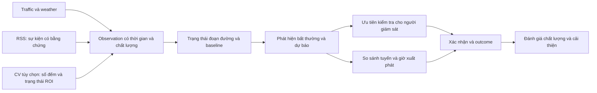

# Cognitive Traffic: định hướng nghiên cứu sản phẩm và dữ liệu

- Phiên bản: 0.2 — 2026-10-26; đã cập nhật ràng buộc 12 điểm MVP của người dùng.
- Yêu cầu để triển khai: [Cognitive Traffic MVP requirements v1](../requirements/cognitive-traffic-mvp-v1.md). Khi phạm vi khác nhau, bản yêu cầu này được ưu tiên.
- Trạng thái: hướng sản phẩm đã được người dùng chọn; phạm vi thử nghiệm và tiêu chí dưới đây là đề xuất nghiên cứu.
- Người dùng chính: người giám sát giao thông. Người dùng phụ: người cần chọn thời điểm và tuyến di chuyển.
- Mục tiêu kỹ thuật: năng lực Data Engineering thể hiện qua dữ liệu đáng tin, replay, kết hợp nguồn đúng thời điểm và đánh giá kết quả sử dụng.
- Ranh giới bằng chứng: đã đọc code/config và nghiên cứu tài liệu; chưa xác minh runtime, nguồn camera, độ phủ thực địa hoặc hiệu quả mô hình. Tài liệu này chưa phải implementation plan.

## 1. Câu hỏi sản phẩm

Hệ thống cần trả lời: đoạn đường nào đang bất thường, có thể xấu đi trong 15 phút tới không, bằng chứng nào hỗ trợ nhận định, và dữ liệu đáng tin đến đâu?

Người giám sát dùng câu trả lời để ưu tiên kiểm tra và xử lý cảnh báo. Người đi đường dùng cùng trạng thái và dự báo để so sánh các tuyến/giờ xuất phát trong vùng đã quan sát được.

| Người dùng | Quyết định cần hỗ trợ | Đầu ra tối thiểu |
|---|---|---|
| Người giám sát | Đoạn nào cần xem trước? | Danh sách cảnh báo theo mức ảnh hưởng và độ mới; hiển thị riêng mức tin cậy |
| Người giám sát | Bất thường có thật hay do nguồn lỗi? | Lịch sử tốc độ, baseline cùng khung giờ, tình trạng nguồn và bằng chứng liên quan |
| Người giám sát | Có đang phục hồi hoặc lan sang đoạn tiếp theo? | Diễn biến theo thời gian và dự báo ngắn hạn; chỉ đánh giá lan truyền khi có topology và dữ liệu phù hợp |
| Người đi đường | Nên chọn tuyến nào trong các tuyến được hỗ trợ? | Thời gian hành trình ước tính, độ phủ, độ mới và cảnh báo trên tuyến |
| Người đi đường | Đi ngay hay chờ thêm? | So sánh thời gian xuất phát, thời gian trên đường, thời gian đến và mức bất định |

Không đồng nhất phát hiện bất thường với xác định nguyên nhân. Mưa và một tin tai nạn gần đó là bằng chứng bối cảnh; chưa đủ chứng minh nguyên nhân gây ùn tắc.

## 2. Những gì checkout hiện tại hỗ trợ và còn thiếu

Các nguồn dưới đây là đường dẫn tương đối trong repo, phản ánh working tree khi nghiên cứu; nhiều thay đổi cấu trúc chưa được commit.

| Bằng chứng code | Nhận định có giới hạn | Hệ quả nghiên cứu |
|---|---|---|
| [`configs/sources.yaml`](../../configs/sources.yaml) | Có 12 anchor rải ở Hà Nội và TP.HCM; danh sách không mô tả một tuyến liên tục | Giữ nguyên 12 điểm trong MVP, đo coverage tại điểm; không suy từ số anchor ra độ phủ tuyến |
| [`ingestion/traffic.py`](../../src/cognitive_traffic/ingestion/traffic.py) | Gán ID anchor cho phản hồi TomTom; giữ provider payload ở raw event | Kiểm tra segment thực nhận, hướng đường và trùng segment giữa các anchor |
| [`ingestion/news.py`](../../src/cognitive_traffic/ingestion/news.py) | RSS có title/summary/URL; road chưa match, loại `other`, severity/confidence bằng 0 | Cần extraction, geocoding, dedup và thời gian hiệu lực trước khi dùng làm bằng chứng |
| [`forecasting/features/traffic.py`](../../src/cognitive_traffic/forecasting/features/traffic.py) | Builder Python hỗ trợ lịch sử traffic, weather, event và neighbor | Có nền tảng thử nghiệm feature; cần xác minh freshness và tương đương offline/online |
| [`streaming/processors.py`](../../src/cognitive_traffic/streaming/processors.py) | SQL Flink hiện ghi weather/neighbor là NULL, event severity là 0 | Kết hợp nguồn trong luồng production vẫn là khoảng trống ở code đã đọc |
| [`forecasting/training.py`](../../src/cognitive_traffic/forecasting/training.py) | Có walk-forward cho baseline/p50; pinball loss của quantile cuối tính trên training window | Cần đánh giá quantile ngoài mẫu trước khi công bố độ tin cậy |
| [`api/main.py`](../../src/cognitive_traffic/api/main.py) | Có operational read cho traffic, forecast, hotspot và alert; chưa có route/departure endpoint | Luồng tư vấn di chuyển là phần mở rộng được đề xuất |
| [`infra/postgres/schema.sql`](../../infra/postgres/schema.sql) | Bảng roads có geometry nhưng chưa có hợp đồng directed segment, chiều dài và membership tuyến; observation table chưa lưu `available_at` | Cần road mapping và nguồn lịch sử point-in-time; chưa thể lấy API store làm đầy đủ lịch sử khả dụng |

TomTom Flow Segment Data mô tả đoạn gần tọa độ truy vấn, có travel time, confidence, closure và shape. Shape có thể dịch theo zoom để hiển thị; không dùng shape này như ground truth hình học duy nhất. Cần lưu phản hồi gốc trong giới hạn quyền sử dụng và phiên bản ánh xạ. [Tài liệu TomTom](https://docs.tomtom.com/traffic-api/documentation/tomtom-maps/v1/traffic-flow/flow-segment-data).

## 3. Phạm vi pilot được đề xuất

- Giữ đúng 12 điểm hiện tại: 6 Hà Nội và 6 TP.HCM. Mở rộng điểm/hành lang là giai đoạn sau MVP.
- Tất cả 12 điểm có trạng thái nguồn và giao thông, lịch sử, cảnh báo và dự báo khi đủ dữ liệu.
- Luồng tuyến giới hạn ở template hợp lệ được ánh xạ với các điểm hiện có. Bản MVP bắt buộc thể hiện tình trạng tại các điểm quan sát; ETA toàn tuyến và xếp hạng nhanh nhất phụ thuộc gate coverage/ground truth ở mục 5.
- Có thể so hai candidate route cùng điểm đi–đến ở một thành phố nếu hình học và hướng đi đã được kiểm tra. Đây là nghiên cứu template trong phạm vi 12 điểm, không phải lý do thêm điểm.
- Chọn một loại phương tiện trước khi nghiệm thu tuyến; car là giả định nghiên cứu ban đầu. Xe máy cần kiểm tra riêng quyền đi đường, kiểu giao thông và dữ liệu đại diện.
- Forecast 15 phút là mốc chính; 60 phút hỗ trợ so thời điểm tại điểm và được đánh giá riêng. Phục vụ baseline có nhãn khi chưa đủ bằng chứng cho model học máy. Horizon 240 phút chưa là điều kiện nghiệm thu pilot.
- CV là thử nghiệm bổ sung với một góc camera cố định; chỉ đưa vào đường đi chính của sản phẩm sau khi đo được giá trị.

Khảo sát 12 điểm đã chọn: geometry/hướng đường, quyền lưu dữ liệu, coverage theo đoạn và thời gian, nguồn kiểm chứng, chi phí polling, video nếu có. Dùng kết quả để chọn case study và template tuyến; giữ cả 12 điểm trong MVP. Tài liệu này chưa khẳng định thành phố nào có độ phủ tốt hơn.

## 4. Chuỗi năng lực “cognitive”

### Quan sát và đánh giá chất lượng

Tách ba chiều: tình trạng giao thông, tình trạng nguồn và mức tin cậy suy luận. Nguồn mất dữ liệu không tạo trạng thái “đường thông”; cảnh báo nghiêm trọng nhưng thiếu chắc chắn vẫn cần hiện để người giám sát kiểm tra.

Phân biệt observed, stale, missing, unsupported và fetch_error; chỉ công bố observed_zero khi nguồn thực sự đo được bằng 0. Freshness dựa trên lịch lấy mẫu và độ trễ thực đo, không dựa riêng vào thời gian API trả lời.

### Hiểu bất thường và bối cảnh

Baseline đầu tiên: tốc độ hoặc travel time theo đoạn đường, khung giờ, loại ngày; thêm mức giảm đột ngột và yêu cầu kéo dài để giảm cảnh báo chập chờn. Một state machine nhỏ quản lý candidate → active → resolved; xác nhận của người giám sát là thuộc tính riêng.

Đo cảnh báo ở cấp sự kiện sau khi gộp các tín hiệu liên tiếp. Nhãn gồm thời điểm bắt đầu/kết thúc, vị trí, nguồn xác nhận, mức chắc chắn và khả năng quan sát. Tránh tính mỗi poll liên tiếp thành một incident mới.

Với RSS, nghiên cứu lần lượt: lọc tin có ích → loại sự kiện → vị trí/hướng đường → thời điểm xảy ra và hết hiệu lực → gộp nhiều bài cùng sự kiện. Publication time không mặc nhiên là incident time. Giữ trạng thái ambiguous/unmatched, evidence span và URL. Có thể so rules với một bộ trích xuất có cấu trúc; chỉ chọn phương pháp phức tạp hơn khi cải thiện tập nhãn và chi phí phù hợp.

### Dự báo và biết giới hạn

So persistence, seasonal baseline và LightGBM trên các fold thời gian như nhau. Đánh giá cả giờ cao điểm, ngày mưa, dữ liệu thiếu và đoạn đường khác nhau. Tách chất lượng dự báo tốc độ, chất lượng cảnh báo và chất lượng khoảng bất định.

Kiểm tra coverage thực nghiệm và độ rộng p10–p90 ngoài mẫu; không coi tên quantile là chứng nhận calibration. Conformal cho chuỗi thời gian là hướng nghiên cứu sau bước này, có xét phụ thuộc thời gian và distribution shift. [Nghiên cứu ICML](https://proceedings.mlr.press/v162/zaffran22a.html).

## 5. Tư vấn tuyến và thời điểm: phạm vi đủ dùng

### Bắt đầu với tuyến định nghĩa sẵn

Nghiên cứu hai candidate route đã kiểm tra tính liên tục, hướng đi, loại phương tiện và hạn chế rẽ, sử dụng các điểm hiện có. MVP có thể hiển thị route geometry và tình trạng các điểm quan sát mà chưa có full-edge travel time. Để vượt gate ETA, mỗi route cần danh sách directed segment có thứ tự, chiều dài và network/mapping version. Một anchor hoặc một tên đường chưa phải một edge có thể định tuyến.

OSRM có thể tạo candidate geometry và alternatives, nhưng availability của alternatives không được bảo đảm. ETA của engine cần được phân biệt với ETA từ dữ liệu/mô hình dự án. [OSRM Route Service](https://project-osrm.org/docs/v5.24.0/api/#route-service).

Chưa cần vận hành routing engine mới trong pilot với tuyến cố định. Nếu nhu cầu mở sang điểm đi–đến tự do được chứng minh, nghiên cứu OSRM/Valhalla theo vehicle profile, mapping và chi phí cập nhật. Valhalla có `date_time` và time-dependent routing, nhưng vẫn cần cung cấp traffic data phù hợp. [Valhalla API](https://valhalla.github.io/valhalla/api/route/api-reference/), [historical traffic](https://valhalla.github.io/valhalla/concepts/historical-traffic/).

### ETA phải phụ thuộc thời điểm đến từng đoạn

Với route có các đoạn nối tiếp, thời điểm vào đoạn sau bằng thời điểm vào đoạn trước cộng thời gian đi đoạn trước. Dùng tốc độ/travel time dự báo tại thời điểm xe dự kiến đến đoạn đó, kèm thời gian chờ nút giao nếu nguồn/nhãn yêu cầu. Một snapshot tốc độ tại giờ xuất phát chỉ là baseline để so sánh.

Không chuyển speed = 0 hoặc closure thành ETA hữu hạn bằng cách thay bằng một tốc độ nhỏ tùy ý. Phải phân biệt tắc tạm thời, cấm đi và không có đo đạc; đoạn thiếu dữ liệu dùng fallback được ghi rõ hoặc không đủ điều kiện khuyến nghị.

Khoảng dự báo tốc độ từng đoạn không cộng trực tiếp thành khoảng dự báo travel time tuyến. Cần tính chuyển đổi và phụ thuộc giữa các đoạn; ưu tiên route-level residual trên hành trình đã quan sát nếu đủ dữ liệu, hoặc đánh giá một phương pháp mô phỏng có xét tương quan. Trước khi kiểm chứng, chỉ hiển thị range mô tả hoặc chỉ số bất định với nhãn phù hợp, chưa gọi là khoảng tin cậy đã hiệu chuẩn.

Coverage báo theo chiều dài đoạn có dữ liệu đủ mới, đồng thời kiểm tra riêng bottleneck quan trọng. Một tuyến có coverage cao vẫn có thể thiếu đúng nút quyết định ETA. Nếu ranking thay đổi khi thay các giả định hợp lý cho đoạn thiếu, trả về “chưa đủ dữ liệu để phân biệt”.

### Chọn giờ xuất phát theo mục tiêu người dùng

So đi ngay với đi sau 15 phút trước; thêm các mốc khác khi horizon đã được đánh giá. Toàn bộ phép so tại thời điểm `t0` chỉ dùng dữ liệu/model đã khả dụng ở `t0`, kể cả khi departure ở tương lai. Đoạn cuối phải nằm trong vùng thời gian dự báo được hỗ trợ; không ngoại suy im lặng.

| Mục tiêu | Đại lượng so sánh |
|---|---|
| Đến sớm nhất | Thời điểm đến = giờ xuất phát + thời gian hành trình |
| Ít thời gian trên đường | Thời gian hành trình; hiển thị thêm thời gian chờ trước xuất phát |
| Đến trước hạn | Khả năng đến đúng hạn nếu đã được kiểm chứng; nếu chưa thì hiển thị ETA và giới hạn |

Đi sau có thể ít phút trên đường nhưng đến muộn hơn. UI phải trình bày rõ hai kết quả này. Nếu lợi ích giữa hai lựa chọn nhỏ hơn sai số thực nghiệm, hiển thị tương đương thay vì khẳng định tuyến/giờ tối ưu.

FHWA dùng percentile travel time và buffer/planning time để mô tả độ ổn định hành trình. Đây là gợi ý chỉ số sản phẩm; percentile thực nghiệm cần đủ dữ liệu đúng route và khung giờ. [FHWA Travel Time Reliability](https://ops.fhwa.dot.gov/publications/tt_reliability/ttr_report.htm).

## 6. Computer vision như nguồn đo bổ sung

Thử nghiệm đầu: một camera cố định → detector pretrained → tracker → đếm qua vạch theo hướng và quan sát ROI → tổng hợp theo cửa sổ. Dùng clip được phép sử dụng trước khi nghiên cứu live stream.

- Flow: số xe qua vạch trên cửa sổ thời gian, theo hướng và nhóm phương tiện nếu đã kiểm chứng.
- ROI count: số xe hiện diện trong vùng quan sát; chưa phải mật độ xe/km.
- Stationary fraction: tỷ lệ track dừng theo ngưỡng đã hiệu chuẩn; không dùng chuyển động pixel như tốc độ km/h.
- Queue state: mức hàng chờ theo vùng hoặc nhãn ordinal; chỉ dùng mét khi có calibration/ground truth hình học.
- Camera quality: camera offline, che khuất, thay đổi góc nhìn; các trạng thái này tạo missingness thay vì count = 0.

ROI/line crossing/direction tracking là các primitive đã được tài liệu hóa; đọc DeepStream để tham khảo cách tổ chức bài toán, chưa chọn nó làm dependency. [NVIDIA analytics](https://docs.nvidia.com/metropolis/deepstream/9.1/text/DS_plugin_gst-nvdsanalytics.html).

AI City cung cấp bài toán đếm theo chuyển động và đánh giá cả sai số lẫn hiệu suất. Track 2021 chỉ xét car/truck; benchmark này chưa xác nhận khả năng đếm xe máy ở Việt Nam. Tập đánh giá địa phương cần có nhiều mức đông xe, che khuất, sáng/tối và mưa nếu sản phẩm tuyên bố hỗ trợ các điều kiện đó. [AI City Data and Evaluation](https://www.aicitychallenge.org/2021-data-and-evaluation/).

Chỉ kết luận CV cải thiện forecasting khi camera và traffic ground truth trùng vị trí, hướng và thời gian. Nếu chỉ có video benchmark nước ngoài, kết quả là bằng chứng pipeline CV riêng; chưa là bằng chứng tích hợp pilot Việt Nam.

## 7. Phần Data Engineering cần làm nổi bật

| Hợp đồng/ranh giới | Nội dung cần nghiên cứu và nghiệm thu |
|---|---|
| Network registry | Directed segment, geometry, chiều dài, vehicle access, route membership; mapping anchor/provider/camera có hiệu lực theo thời gian |
| Observation | Source identity, event/ingestion/availability time, measurement window, đơn vị, provenance, quality state; count/flow/speed khác schema hoặc loại measurement |
| Context event | Incident time nếu biết, publication time, first-seen/available time, expiry, evidence reference, dedup và match confidence |
| Feature snapshot | Prediction time, feature version, input IDs, freshness, missingness; truy lại đúng dữ liệu biết được khi ra quyết định |
| CV artifact | Video reference/checksum, time range, camera clock, ROI/calibration/model version, processing attempt; phân biệt observation time và giờ xử lý replay |
| Decision/outcome | Forecast/alert/recommendation ID, model/rules version, candidate routes, departure objective, evidence và kết quả xác nhận |

Video và artifact lưu object storage; Kafka mang references và observation tổng hợp. Giới hạn lưu video/payload theo quyền sử dụng và ngân sách. PostgreSQL phục vụ trạng thái vận hành và truy vết quyết định; lịch sử gốc và dataset manifest nằm trong lake.

Replay phải phân biệt hai chế độ: tái hiện đúng quyết định lúc đó bằng dữ liệu/version đã khả dụng; và xử lý lại lịch sử bằng model/rules mới để nghiên cứu. Không trộn kết quả reprocessing với lịch sử điều hệ thống đã biết.

Đảm bảo idempotency theo nguồn/cửa sổ/version; không đếm lại observation do retry. Khi cùng video được xử lý bằng model mới, giữ phiên bản kết quả và chọn version phục vụ rõ ràng. So offline/online bằng cùng input snapshot, feature definition và policy lateness.

Mỗi quyết định demo phải truy ngược được: recommendation/alert → feature snapshot → observations → source payload hoặc video window. Đây là điểm thể hiện năng lực Data Engineering rõ hơn số lượng dịch vụ.

## 8. Thứ tự nghiên cứu và điều kiện chuyển bước

| Bước | Câu hỏi | Artifact đầu ra | Điều kiện chuyển bước |
|---|---|---|---|
| R0: nguồn và pilot | 12 điểm hiện tại đo được gì và hỗ trợ template tuyến nào? | Coverage matrix của 12 điểm, network mapping, source-use register và cost estimate | Xác nhận quyền sử dụng; hiển thị rõ điểm thiếu và các giới hạn tuyến; có phương án ground truth. Không thêm/đổi điểm để đạt gate |
| R1: baseline giám sát | Phát hiện bất thường tốt hơn threshold đơn giản không? | Event label set, baseline report, các case outage/recovery | Quy tắc cố định trước test; đo false alarms và latency trên tập tách biệt; nguồn lỗi không bị hiểu là đường thông |
| R2: dự báo ngắn hạn | Có thêm thời gian cảnh báo so với persistence/seasonal không? | Walk-forward report theo horizon và slice, calibration report | Có cải thiện hữu ích trên các fold; không dựa vào train metrics; xử lý dữ liệu thiếu minh bạch |
| R3: tuyến và departure | 12 điểm hỗ trợ tư vấn gì; có đủ cơ sở cho ETA/ranking không? | Template tuyến, so trạng thái và giờ đi tại điểm, báo cáo eligibility ETA và replay tại `t0` | MVP cung cấp so sánh tại điểm và lý do thiếu coverage; chỉ kích hoạt ETA khi mapping, coverage và validation đạt policy |
| R4: context | Weather/RSS có cải thiện hoặc xác nhận sự kiện không? | Extraction/geocoding report và ablation từng nhóm feature | Đánh giá cùng cohort; dữ liệu có sẵn đúng thời điểm; nếu chỉ xác nhận muộn thì dùng cho review thay vì dự báo sớm |
| R5: CV | Camera có giảm điểm mù hoặc cải thiện quyết định không? | Count/queue label set, CV accuracy/runtime report, paired ablation nếu đủ dữ liệu | Có ích với bài toán pilot và nằm trong ngân sách; nếu thiếu paired data, giữ kết quả nghiên cứu riêng |

R0–R3 là đường chính để phục vụ hai nhóm người dùng. R4–R5 là phần bổ sung có điều kiện; nguồn camera có thể được khảo sát sớm ở R0 để tránh thu thập trễ.

Trước mỗi test, chốt dataset split, đơn vị đánh giá, baseline, ngưỡng chấp nhận, sampling cadence, freshness và ngân sách tính toán. Các giá trị này là quyết định preregistered của từng thử nghiệm, chưa được xác nhận bằng tài liệu này. Không thay ngưỡng sau khi xem test set để công bố đạt.

## 9. Bằng chứng nghiệm thu cần thu thập

- **Nguồn:** coverage theo directed segment × thời gian; freshness p95; missing/error/late rate; số request và storage/compute thực dùng.
- **Cảnh báo:** precision/recall cấp event; false alarms trên monitored segment-hour có nhãn; detection delay và warning lead time báo riêng; số cảnh báo trùng/chập chờn.
- **Dự báo:** MAE/bias theo horizon và slice; so baseline cùng fold/cohort; empirical coverage và interval width ngoài mẫu.
- **Tuyến:** ETA error theo route/departure; sai khác so snapshot baseline; fallback exposure; độ nhạy ranking khi thiếu dữ liệu; phân biệt observed ETA với estimated ETA.
- **Khuyến nghị:** regret so lựa chọn tốt nhất trong tập candidate được đánh giá offline; không gọi là tối ưu toàn mạng. Counterfactual tuyến không đi phải ghi rõ là estimated nếu không có quan sát đồng thời phù hợp.
- **CV:** count MAE theo cửa sổ/hướng/class; queue-state precision/recall; runtime, end-to-end latency, dropped frames; lỗi theo điều kiện quay.
- **Pipeline:** retry/replay không tạo kết quả trùng ngoài policy versioning; truy vết được nguồn; late data không thay đổi âm thầm quyết định đã phát; offline/online parity có bằng chứng.
- **Người dùng:** kịch bản phát hiện → kiểm tra bằng chứng → xác nhận/resolution; kịch bản so hai tuyến và giờ đi; kịch bản thiếu dữ liệu. Đo khả năng hiểu cảnh báo và thời gian xác minh khi có người tham gia; chưa có user study thì ghi là walkthrough nội bộ.

So sánh thêm nguồn bằng ablation trên cùng các hàng đủ điều kiện ở cả hai phương án và cùng policy khả dụng; báo riêng phần tăng coverage. Hai nguồn đồng ý chỉ là agreement, chưa phải independent ground truth.

## 10. Quy tắc hạn chế overengineering

1. Mỗi nguồn/model/service mới phải gắn với một quyết định người dùng và một baseline có thể đo.
2. Tận dụng Kafka, Flink, MinIO, PostgreSQL và Airflow hiện có; schema/topic mới chỉ khi hợp đồng dữ liệu cần tách.
3. Chưa thêm graph database cho vài tuyến/neighbor mappings; topology dạng file versioned hoặc bảng quan hệ đủ để thử nghiệm.
4. Chưa thêm online feature store khi feature registry, snapshot và kiểm tra offline/online còn giải quyết được nhu cầu.
5. Chỉ nghiên cứu GNN/Transformer sau khi có mạng đường và dữ liệu phù hợp, đồng thời baseline đơn giản đã được đánh giá nghiêm túc.
6. Chưa mở rộng sang nhận diện biển số, tracking đa camera, tự điều khiển đèn, chatbot hoặc dự báo toàn thành phố trong pilot này.
7. Thêm CV vì phép đo bổ sung; dùng kết quả thử nghiệm để quyết định có cần GPU/streaming service riêng.

## 11. Đề xuất quyết định tiếp theo

Khóa phạm vi nghiên cứu vào R0 trước: khảo sát đúng 12 điểm hiện tại, lập template tuyến dựa trên geometry hợp lệ và chọn vehicle mode cho template. Sau R0, triển khai năng lực giám sát/cảnh báo trên 12 điểm theo bản yêu cầu đã tổng hợp; route/departure dùng chung observation và forecast với gate R3. Mở rộng mạng đường là giai đoạn sau MVP.

Một demo có sức thuyết phục phải cho người xem theo dõi được cùng một sự kiện: dữ liệu thay đổi → cảnh báo có bằng chứng → forecast → ảnh hưởng đến lựa chọn tuyến/giờ đi → outcome → replay giải thích lại quyết định.
