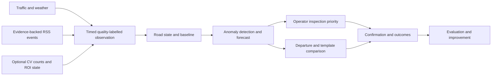

# Cognitive Traffic: product and data research direction

Version 0.3, canonical English edition, 2026-10-26. The user selected this product direction; experimental scope and criteria remain research proposals. [MVP requirements](../requirements/cognitive-traffic-mvp-v1.md) take precedence on scope. Operators are primary, travelers choosing routes/departures secondary. The engineering objective is reliable data, replay, point-in-time source fusion and measurable decision outcomes.

Evidence boundary: the original research inspected code/configuration and references, not runtime, camera sources, field coverage or model effectiveness. Code-state findings below describe that historical inspection and may differ from subsequent implementation. This is not an implementation plan. The complete historical edition is retained in Git at `43ac84e62ec06a0a92429d1db5d87ca056f6b804`.

## 1. Product questions

Which road point is unusual, might it worsen in 15 minutes, what supports that conclusion and how trustworthy is the data? Operators prioritize checks/alerts; travelers compare supported routes/departures using the same state and forecasts.

| User | Decision | Minimum evidence |
|---|---|---|
| Operator | What needs attention first? | Alerts by impact/freshness, confidence shown separately |
| Operator | Real anomaly or broken source? | Speed history, same-time baseline, source state and evidence |
| Operator | Recovery or downstream propagation? | Trend/short forecast; propagation only with suitable topology/data |
| Traveler | Which supported route? | Estimated travel time, coverage, freshness and route alerts, subject to ETA gates |
| Traveler | Leave now or wait? | Departure time, time on road, arrival time and uncertainty |

Anomaly detection does not identify cause. Rain and a nearby accident story are context, not proof of congestion causality.

## 2. Historical checkout capabilities and gaps

| Source | Bounded finding at research time | Implication |
|---|---|---|
| [Point config](../../configs/sources.yaml) | Twelve Hanoi/HCMC anchors, no continuous route | Preserve 12 points; point count is not route coverage |
| [Traffic ingestion](../../src/cognitive_traffic/ingestion/traffic.py) | Assigns anchor ID to TomTom response and retains raw payload | Verify actual provider segment/direction and shared-segment anchors |
| [News ingestion](../../src/cognitive_traffic/ingestion/news.py) | Title/summary/URL, unmatched road, other event type, zero severity/confidence | Extract/geocode/dedup/expire before treating as evidence |
| [Python features](../../src/cognitive_traffic/forecasting/features/traffic.py) | Traffic/weather/event/neighbor builders | Validate freshness and offline/online parity |
| [Stream processors](../../src/cognitive_traffic/streaming/processors.py) | Flink SQL weather/neighbor NULL, event severity zero | Source fusion was not established in that stream path |
| [Training helpers](../../src/cognitive_traffic/forecasting/training.py) | Walk-forward baselines/p50; final quantile pinball on training window | Require held-out quantile evaluation before uncertainty claims |
| [API](../../src/cognitive_traffic/api/main.py) | Traffic/forecast/hotspot/alert reads, no departure/route endpoint | Travel advice remains an extension |
| [Database schema](../../infra/postgres/schema.sql) | Roads geometry, but no directed-length/membership contract; no observation available_at in inspected version | Mapping and historical availability cannot be inferred from the old read store |

TomTom Flow Segment Data describes the segment nearest the queried coordinate, travel time, confidence, closure and shape. Display shape may shift with zoom; it is not sole geometric ground truth. Preserve raw response within rights/retention and version mappings. [TomTom contract](https://docs.tomtom.com/traffic-api/documentation/tomtom-maps/v1/traffic-flow/flow-segment-data).

## 3. Pilot scope

Keep six existing points in each city. All 12 need source/traffic state, history, alerts and eligible forecasts. Route templates use existing points and valid continuous geometry/direction; point-state display is mandatory while whole-route ETA/fastest ranking requires coverage/ground truth gates. Two same-OD candidates in one city are conditional on geometry verification, not permission to add points. Start with car mode; motorcycle access, traffic behavior and representative data require separate validation.

+15 is primary; evaluate +60 separately for departure support. Serve a labelled baseline when learned forecasting lacks evidence. +240 is outside pilot acceptance. CV is a supplementary single-fixed-camera experiment and joins the core only after measured value.

Survey all points for geometry/direction, storage rights, segment/time coverage, verification sources, polling cost and optional video. Select case study/templates from evidence; do not assume one city has better coverage.

## 4. The cognitive capability chain

Separate traffic state, source state and inference confidence. An outage does not mean free flow; uncertain severe events may deserve inspection. Distinguish observed/stale/missing/unsupported/fetch_error; observed zero requires an actual zero measurement. Freshness uses real cadence/delay, not just API response time.

Start with segment/time-of-day/day-type speed or travel-time baselines, sudden drops and persistence to reduce flapping. A candidate→active→resolved state machine is separate from operator confirmation. Evaluate event-level labels with onset/end, location, verification source, confidence and observability; consecutive polls are not new incidents.

For RSS: filter useful articles, extract event type/location/direction/occurrence/expiry, then deduplicate articles about the same event. Publication is not incident time. Retain ambiguous/unmatched status, evidence spans and URLs. Compare rules against structured extraction; choose complexity only for labelled-set improvement within cost.

Compare persistence, seasonal baselines and LightGBM on common temporal folds and peak/rain/missing/road slices. Separate speed quality, alert quality and uncertainty quality. Test out-of-sample p10–p90 coverage/width; quantile names do not prove calibration. Time-series conformal methods are later research with temporal dependence/shift considered. [ICML research](https://proceedings.mlr.press/v162/zaffran22a.html).

## 5. Route and departure research

### Verified templates first

Validate two candidates for continuity, direction, vehicle access and turn restrictions using existing points. Geometry plus observed-point state can ship before full-edge travel times. ETA eligibility requires ordered directed segments, lengths and network/mapping version; an anchor/street name is not a routable edge.

OSRM can supply candidate geometry/alternatives, whose availability is not guaranteed. Distinguish engine ETA from project-derived ETA. [OSRM service](https://project-osrm.org/docs/v5.24.0/api/#route-service). A new engine is unnecessary for fixed pilot templates. If arbitrary-OD demand is established, evaluate OSRM/Valhalla vehicle profile/mapping/update cost. Valhalla date_time/time-dependent routing still needs suitable traffic input. [Valhalla route API](https://valhalla.github.io/valhalla/api/route/api-reference/), [historical traffic](https://valhalla.github.io/valhalla/concepts/historical-traffic/).

### Arrival at each segment matters

The next entry time is previous entry plus traversal time. Use the speed/travel forecast at expected arrival, including intersection delay if labels require it. Departure-time snapshot speed is a baseline only. Do not replace zero/closure with arbitrary small speed to manufacture finite ETA. Distinguish temporary congestion, prohibited travel and unobserved sections; use declared fallback or reject recommendation eligibility.

Segment speed intervals do not directly sum into route travel-time intervals. Account for transformation and dependence, preferably route-level residuals on observed trips or an evaluated correlated simulation. Before validation label a range descriptive, not calibrated confidence.

Report fresh-data length coverage and bottleneck coverage separately: a high overall percentage can miss the decisive junction. If plausible missing-section assumptions change ranking, report insufficient evidence.

### Departure objectives

Begin with now versus +15; add times only inside evaluated horizons. At common `t0` use only data/models already available at `t0`, including future departure cases. Last-segment entry must remain inside supported prediction time; do not silently extrapolate.

| Objective | Comparison |
|---|---|
| Earliest arrival | Departure time + journey time |
| Least time on road | Journey time, with predeparture waiting shown separately |
| Arrive before deadline | Validated on-time probability; otherwise ETA and limits |

Leaving later may reduce travel minutes yet arrive later. Show both. If benefit is smaller than empirical error, show equivalence rather than optimality. FHWA percentile/buffer/planning-time measures can guide reliability features, but empirical percentiles need sufficient matching route/time data. [FHWA report](https://ops.fhwa.dot.gov/publications/tt_reliability/ttr_report.htm).

## 6. CV as an additional measurement source

Initial experiment: permitted fixed-camera clip→pretrained detector→tracker→directional line crossing/ROI→window aggregation. Explore live streaming only after lawful clips.

- Flow is line crossings per time window, by direction/class only when evaluated.
- ROI count is vehicles present, not vehicles/km density.
- Stationary fraction needs calibrated track-stop thresholds; pixel motion is not km/h.
- Queue state is region/ordinal based; meters need geometry calibration/ground truth.
- Offline camera, occlusion or changed viewpoint yields missingness, not zero.

DeepStream documents ROI/line/direction primitives; it is a conceptual reference, not an adopted dependency. [NVIDIA analytics](https://docs.nvidia.com/metropolis/deepstream/9.1/text/DS_plugin_gst-nvdsanalytics.html). AI City 2021 counts movements and evaluates error/efficiency but car/truck coverage does not establish motorcycle support. Local evaluation needs density, occlusion, light/night and rain conditions for each product claim. [AI City evaluation](https://www.aicitychallenge.org/2021-data-and-evaluation/).

Claim forecast improvement only with colocated, direction/time-aligned camera and traffic ground truth. Foreign benchmark video establishes a standalone CV pipeline, not Vietnamese pilot integration.

## 7. Data Engineering boundaries

| Contract | Required content |
|---|---|
| Network registry | Directed segment/geometry/length/access/route membership; time-valid anchor/provider/camera mapping |
| Observation | Source identity, event/ingestion/availability time, window, units, provenance/quality; distinguish count/flow/speed schemas |
| Context event | Occurrence if known, publication, first-seen/availability, expiry, evidence, dedup/match confidence |
| Feature snapshot | Prediction time/version/input IDs/freshness/missingness; reconstruct information known at decision |
| CV artifact | Video reference/checksum/range/camera clock, ROI/calibration/model version/attempt; observation time differs from replay processing |
| Decision/outcome | Forecast/alert/recommendation ID, model/rule version, candidates, departure objective, evidence and confirmation |

Store video/artifacts in object storage; Kafka carries references and aggregated observations. Bound retention by rights/budget. PostgreSQL owns operational decision state; lake owns raw history/manifests. Reproduce old decisions with then-available data/versions separately from new-logic reprocessing. Source/window/version idempotency prevents retry recounting. Preserve result versions for new video models and select serving version explicitly. Demonstrate offline/online parity on shared snapshots and lateness policy.

Every demo decision must trace recommendation/alert→snapshot→observations→payload/video window. This demonstrates engineering more clearly than service count.

## 8. Research order and gates

| Step | Question | Artifact | Exit gate |
|---|---|---|---|
| R0 sources/pilot | What do the 12 points observe and which templates are supported? | Coverage matrix, network mapping, rights register, cost estimate | Rights, explicit missing points/route limits, ground-truth plan; no added/replaced points |
| R1 monitoring baseline | Better than a simple threshold? | Event labels, baseline and outage/recovery cases | Freeze rules before separate test; measure false alarms/latency; failure is not free flow |
| R2 short forecasting | Useful lead time beyond persistence/seasonal? | Horizon/slice walk-forward and calibration report | Useful fold-level improvement, no train-metric claims, transparent missingness |
| R3 departure/routes | What advice is possible; is ETA/ranking justified? | Templates, point comparison, ETA eligibility and t0 replay | Mandatory point evidence/reasons; ETA only after mapping/coverage/validation |
| R4 context | Does weather/RSS improve or corroborate? | Extraction/geocoding, feature ablation | Same cohort and availability; late corroboration belongs in review, not early prediction |
| R5 CV | Fewer blind spots/better decisions? | Count/queue labels, accuracy/runtime, paired ablation if eligible | Useful within budget; without paired data retain separate research |

R0–R3 serve both users; R4–R5 are conditional. Camera discovery can start in R0. Preregister split, evaluation unit, baseline, threshold, cadence/freshness and compute budget before each test. This document establishes no measured thresholds; never tune on test then claim success.

## 9. Acceptance evidence to collect

Source: directed-segment×time coverage, freshness p95, missing/error/late rates, requests and storage/compute. Alerts: event precision/recall, false alarms per labelled monitored-segment-hour, separate detection delay/warning lead time, duplication/flapping. Forecasts: horizon/slice MAE/bias, common-fold baselines, held-out coverage/width. Routes: route/departure ETA error, snapshot-baseline difference, fallback exposure and missing-data ranking sensitivity; distinguish observed/estimated ETA.

Recommendations: offline regret against best evaluated candidate, never whole-network optimality. Untraveled-route counterfactuals remain estimated without suitable simultaneous observation. CV: window/direction/class count MAE, queue precision/recall, runtime, E2E latency, dropped frames and condition slices. Pipeline: retry/replay idempotency, provenance, no silent retroactive decision changes from late data, offline/online parity.

Users: detection→evidence inspection→confirmation/resolution, route/departure comparison and missing-data cases. Measure comprehension/verification time only with participants; absent a user study call it an internal walkthrough. Source ablation uses the same eligible rows/availability policy; report coverage gains separately. Agreement between sources is not independent ground truth.

## 10. Avoid overengineering

Every source/model/service needs a user decision and measurable baseline. Reuse Kafka/Flink/MinIO/PostgreSQL/Airflow; new schema/topic only for a required contract. A versioned file or relational topology is sufficient for a few templates/neighbors; no graph database yet. No feature store while registry/snapshots/parity checks suffice. GNN/Transformer requires suitable road data and rigorously evaluated simple baselines first. Exclude plates, multicamera tracking, signal control, chatbots and citywide forecasting. Add CV for a useful measurement; only measured need justifies GPU/separate streaming service.

## 11. Next approved direction

Start R0 with the exact 12 points, lawful source survey, valid route geometry and template vehicle mode. Then implement monitoring/alerts under the requirements, with departure/routes sharing observations/forecasts and R3 gates. Network expansion is post-MVP. A convincing demo follows one event through changed data→evidenced alert→forecast→departure/template consequence→outcome→explanatory replay; until each stage is verified label the limits.
