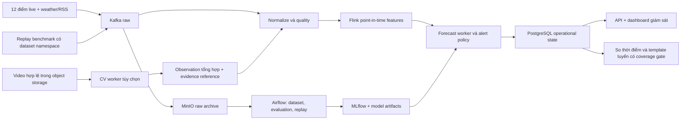

# Đối chiếu LargeST, smart-traffic và smart_traffic_routing với Cognitive Traffic

- Ngày nghiên cứu: 2026-10-26. Phiên bản: 1.0.
- Trạng thái quyết định: người dùng đã duyệt các khuyến nghị; đã đưa vào mục 12 của bản yêu cầu MVP v1.1. Evidence code/dataset trong báo cáo vẫn giữ giới hạn bên dưới.
- Phạm vi đối chiếu: [MVP 12 điểm](../requirements/cognitive-traffic-mvp-v1.md), người giám sát là chính, hỗ trợ chọn giờ/tuyến là phụ, ưu tiên Data Engineering.
- Bằng chứng: đọc README, code ingestion/preprocessing/training/worker/streaming/routing, notebook chuẩn bị dữ liệu và bài báo/nguồn phân phối liên quan.
- Giới hạn: chưa chạy ba repo, chưa tải các dataset đầy đủ, chưa huấn luyện model hoặc đo throughput/accuracy. Dataset được xem ở mức tài liệu, metadata được mô tả, schema và loader; chưa xác minh chất lượng raw files bằng profiling.
- Báo cáo đưa ra quyết định nghiên cứu; chưa thay đổi yêu cầu MVP hoặc triển khai kiến trúc mới.

## 1. Kết luận để ra quyết định

Ba repo cung cấp ba phần bổ sung nhau: LargeST cho phương pháp tổ chức dữ liệu và benchmark; smart-traffic cho tách modality/inference/stream/storage; smart_traffic_routing cho luồng sản phẩm từ dự đoán đến lựa chọn tuyến. Mức phù hợp của ý tưởng và mức hoàn thiện implementation phải được đánh giá riêng.

| Repo | Phần phù hợp nhất | Áp dụng cho MVP | Giới hạn cần giữ |
|---|---|---|---|
| LargeST | Sensor metadata, network-based adjacency, long-history benchmarking | Học registry, subset/manifest, temporal split, đánh giá accuracy và chi phí | Dữ liệu chính là flow California, không phải speed hay ground truth 12 điểm Việt Nam |
| smart-traffic | Kafka worker riêng cho CV/ML, per-entity state, schema và metrics | Tham khảo ranh giới worker và CV result contract; tận dụng Flink/MinIO/PostgreSQL hiện có | Dataset khác địa lý/thời gian; prediction worker hiện horizon 0; routing chỉ lookup graph distances |
| smart_traffic_routing | Trải nghiệm chọn OD, nhìn route và dự đoán tác động | Học cách trình bày decision flow và giải thích lựa chọn | Routing code dùng graph thủ công và dummy features; chưa là bằng chứng adaptive routing theo dữ liệu live |

Khuyến nghị dataset: METR-LA cho nhánh speed benchmark đầu tiên; một vài sequence UA-DETRAC cho CV; LargeST subset cho flow/scale experiment sau. NYC TLC chưa có yêu cầu cụ thể trong MVP này. Dữ liệu thật tại 12 điểm vẫn quyết định khả năng sử dụng ở Việt Nam.

## 2. Snapshot và nguồn chính

| Repo | Commit được đọc | Ngày commit |
|---|---|---|
| liuxu77/LargeST | `b7c6ff5f7f0c10051ed10a319b2cfe58021312f9` | 2023-11-01 |
| zubiiabbasi/smart-traffic | `02f33a82e80cbae8bd034d5e3616da82dc2cb014` | 2026-05-11 |
| devarshpatel1506/smart_traffic_routing | `24d92f7b15ccae72da14a99ca9bc5f579bb41e91` | 2025-09-25 |

Repo routing có recursive tree bị GitHub cắt ngắn; đã đọc thêm directory listings của `scripts/` và `streaming/` để lấy các file trọng tâm. Không kết luận đã audit toàn bộ file/binary/PDF trong repo. Các đường dẫn nguồn dưới đây được pin theo commit để kết luận có thể kiểm tra lại.

## 3. LargeST: học cách làm dữ liệu và benchmark

### Dataset và phạm vi sử dụng

Bài báo mô tả dữ liệu PeMS mainline tại California, 2017–2021, chu kỳ gốc 5 phút; CA có 8.600 sensor, GLA 3.834, GBA 2.352 và SD 716. Target chính là traffic flow. Metadata gồm vị trí, đường, hướng, làn và district. Sensor graph dựa trên road-network distance qua OSRM; adjacency sau chuẩn hóa phục vụ mô hình, chưa phải bảng travel-time edges. Thí nghiệm paper dùng dữ liệu 2019, resample 15 phút và chia thời gian 60/20/20. [Bài báo, mục 4–5](https://arxiv.org/html/2306.08259v2).

README trỏ Kaggle với năm file HDF5 lịch sử, một CSV metadata và một NPY adjacency. Code MIT; dataset được tác giả công bố theo CC BY-NC 4.0, khác giấy phép code. Khi chọn baseline bên thứ ba phải đọc giấy phép tương ứng. [README và license dataset](https://github.com/liuxu77/LargeST/blob/b7c6ff5f7f0c10051ed10a319b2cfe58021312f9/README.md).

### Những gì code thực sự làm

- Notebook CA resample bằng `mean().round(0)` và `fillna(0)`. Đây là convention preprocessing; không tự biến kết quả thành tổng số xe trong 15 phút. Cognitive Traffic cần khai báo rõ measurement/unit/aggregation và giữ missing mask.
- Training generator thêm time-of-day/day-of-week, chuẩn hóa và lưu indices train/val/test riêng. Mặc định 12 bước lịch sử và 12 bước tương lai; sau resample đó là bài toán khác cadence 5 phút ở MVP.
- Generator dùng `DataFrame.append`, cần chỉnh tương thích trước khi dùng với pandas 2.x của dự án. Không bê nguyên môi trường nghiên cứu cũ vào production dependencies.

Nguồn: [CA preprocessing notebook](https://github.com/liuxu77/LargeST/blob/b7c6ff5f7f0c10051ed10a319b2cfe58021312f9/data/ca/process_ca_his.ipynb), [training generator](https://github.com/liuxu77/LargeST/blob/b7c6ff5f7f0c10051ed10a319b2cfe58021312f9/data/generate_data_for_training.py).

### Kết luận áp dụng

**Keep:** metadata theo sensor, subsetting theo khu vực, split và target có định nghĩa rõ, đo cả accuracy và chi phí. Có thể dùng một subset nhỏ trước, tăng kích thước để nghiên cứu replay/compaction/benchmark; giới hạn 12 điểm của sản phẩm không cấm một benchmark bên ngoài được gắn nhãn riêng.

**Change:** chuyển HDF5 wide sang canonical long-form có sensor/time/value/unit/quality, lưu provenance và dataset manifest. Chia theo timestamp/target availability, fit transform trên train và kiểm tra ranh giới horizon. Không coi zero luôn là missing hoặc flow là speed.

**Defer:** chạy cả bộ GNN và toàn CA ngay. LargeST có thể giúp nghiên cứu flow/scale, nhưng không trực tiếp huấn luyện một speed model dùng được tại Hà Nội/TP.HCM. Một graph sensor adjacency cũng chưa giải quyết tính hợp lệ của tuyến xe đi.

## 4. smart-traffic: kiến trúc gần nhất, cần chỉnh semantics

### Phần kiến trúc đáng học

Repo có producers cho sensor/GPS/CCTV/weather; YOLO và ML worker giao tiếp qua Kafka; stream jobs ghi Delta; MinIO chứa ảnh kết quả; dashboard đọc snapshot và URL ảnh. Đây là cách tách phần inference/object upload khỏi stream engine để phần tính toán nặng có thể chạy với tài nguyên và retry policy riêng. [Architecture README](https://github.com/zubiiabbasi/smart-traffic/blob/02f33a82e80cbae8bd034d5e3616da82dc2cb014/README.md).

Với Cognitive Traffic, dùng cùng nguyên tắc cho CV worker tùy chọn và forecast worker hiện có. Flink tiếp tục sở hữu event time/features; MinIO lưu artifact; PostgreSQL/API phục vụ operational reads. Chưa có requirement khiến pattern này đòi Spark, Delta, Streamlit hoặc ONNX thay stack hiện tại. ONNX chỉ đáng thêm sau khi profile chỉ ra lợi ích deployment/inference cụ thể.

### Dataset nhiều nguồn chưa đồng nghĩa fusion đã được kiểm chứng

Sensor producer đọc METR-LA speed và giữ timestamp nguồn cùng `ingested_at`; GPS producer đọc taxi NYC dạng pickup/dropoff zone/time và distance; CCTV producer replay UA-DETRAC; weather producer lấy OpenWeatherMap hiện tại. Các nguồn này chưa tự có mapping chung theo vị trí/thời điểm để kiểm chứng một mô hình fusion cho 12 điểm Việt Nam.

NYC TLC trong loader là trip records theo zone, không phải GPS trajectory dọc từng cạnh đường. Nguồn TLC xác nhận các trường pickup/dropoff/time/distance và lưu ý giới hạn độ chính xác. [TLC chính thức](https://www.nyc.gov/site/tlc/about/tlc-trip-record-data.page), [GPS producer](https://github.com/zubiiabbasi/smart-traffic/blob/02f33a82e80cbae8bd034d5e3616da82dc2cb014/producers/gps_producer.py), [sensor producer](https://github.com/zubiiabbasi/smart-traffic/blob/02f33a82e80cbae8bd034d5e3616da82dc2cb014/producers/sensor_producer.py).

### Các điểm cần sửa trước khi tái sử dụng

| Chủ đề | Bằng chứng static | Hệ quả cho dự án |
|---|---|---|
| Horizon | Worker xuất `horizon_minutes: 0`, actual/predicted cùng timestamp | Không lấy kết quả đó làm bằng chứng +15/+60. Cần target shift và target time rõ |
| Evaluation | Trainer dùng `train_test_split(... shuffle=True)` | Chuyển chronological/walk-forward; random split không chứng minh generalization sang tương lai |
| Feature parity | `grouped.shift(1).rolling(...)` tạo rolling trên Series đã flatten; online rolling chỉ theo sensor | Rủi ro cửa sổ chạm ranh giới sensor; cần grouped rolling và kiểm chứng parity trước khi dùng |
| Warm start | Mặc định đọc 30 phút nhưng feature lag_1h cần 12 mẫu cadence 5 phút | Chưa bảo đảm đủ lịch sử sau restart; cần bootstrap đủ window và giới hạn đúng cutoff |

Nguồn: [ML trainer](https://github.com/zubiiabbasi/smart-traffic/blob/02f33a82e80cbae8bd034d5e3616da82dc2cb014/ml/train_speed_model.py), [ML worker](https://github.com/zubiiabbasi/smart-traffic/blob/02f33a82e80cbae8bd034d5e3616da82dc2cb014/ml_predictor_worker/main.py).

| Chủ đề CV/stream | Bằng chứng static | Điều chỉnh cần có |
|---|---|---|
| Counting | `unique_count_5min` là số track ID xuất hiện trong processing-time window | Chưa là flow qua vạch, queue length hoặc density; thêm ROI/line crossing và đánh giá count theo định nghĩa sản phẩm |
| Replay time | CCTV producer gán `time.time()` khi phát lại frame; worker dùng clock hiện tại cho window và stale-drop | Giữ clip/frame time riêng; không diễn giải tốc độ replay thành thời gian quan sát thật |
| Recovery | Tracker/count ở memory; loop commit offset độc lập với publish ack; process có thể return khi lỗi | Không suy ra exactly-once end-to-end. Cần policy fail/retry/DLQ và idempotent sink; kiểm chứng restart/rebalance |
| Raw transport | Frame base64 đi qua Kafka, MinIO nhận ảnh annotated | Với dự án này ưu tiên video/frame references có checksum; giữ raw evidence nếu quyền/retention cho phép |

Nguồn: [YOLO worker](https://github.com/zubiiabbasi/smart-traffic/blob/02f33a82e80cbae8bd034d5e3616da82dc2cb014/yolo_worker/main.py), [CCTV producer](https://github.com/zubiiabbasi/smart-traffic/blob/02f33a82e80cbae8bd034d5e3616da82dc2cb014/producers/cctv_producer.py).

Hai điểm graph/UI cần lưu ý: `graph_analytics.py` tính shortest-path hop count tới landmarks bằng NetworkX; `stream_sensors.py` lookup khoảng cách đó khi speed dưới ngưỡng. Chưa phải tính tuyến mới tránh congestion theo forecast. Metadata loader còn có fallback đặt sensor thật lên synthetic grid khi thiếu CSV; grid này không đủ để xác nhận vị trí nguồn. [Graph analytics](https://github.com/zubiiabbasi/smart-traffic/blob/02f33a82e80cbae8bd034d5e3616da82dc2cb014/spark_jobs/graph_analytics.py), [stream sensors](https://github.com/zubiiabbasi/smart-traffic/blob/02f33a82e80cbae8bd034d5e3616da82dc2cb014/spark_jobs/stream_sensors.py), [metadata loader](https://github.com/zubiiabbasi/smart-traffic/blob/02f33a82e80cbae8bd034d5e3616da82dc2cb014/spark_jobs/load_sensor_metadata.py).

CV converter có điểm tốt: chia theo annotation XML/sequence thay vì random từng frame. Nhưng nó gộp XML từ train/test gốc rồi chia lại; cần manifest và không so kết quả trực tiếp với official benchmark split. Nó đưa mọi object về một class vehicle và bỏ frame không có label; cần xét lại negative frames và class xe máy nếu áp dụng địa phương. [Converter](https://github.com/zubiiabbasi/smart-traffic/blob/02f33a82e80cbae8bd034d5e3616da82dc2cb014/scripts/convert_yolo_fast.py).

**Kết luận:** đây là reference gần nhất cho ranh giới hệ thống và nhánh CV. Dùng ý tưởng tách worker, schema và metrics; sửa time/measurement/evaluation/recovery trước khi tái sử dụng code.

## 5. smart_traffic_routing: đúng hướng trải nghiệm, execution còn minh họa

### Luồng ý tưởng phù hợp

README nối traffic/weather/incident → features → forecasting/classification → edge costs → route → dashboard. Luồng này gần nhu cầu thứ hai của Cognitive Traffic: người dùng thấy dữ liệu thay đổi ảnh hưởng lựa chọn thế nào. Học cách trình bày route cùng predicted conditions và lý do, thay vì thêm chart rời rạc. [README architecture](https://github.com/devarshpatel1506/smart_traffic_routing/blob/24d92f7b15ccae72da14a99ca9bc5f579bb41e91/README.md).

### Dataset và code khác với mức mô tả

- Traffic producer đọc local PeMS CSV có station, flow, occupancy, speed và location, nhưng thay historical timestamp bằng giờ UTC hiện tại rồi phát từng dòng một giây. Incident producer tạo incident ngẫu nhiên; weather producer lấy Open-Meteo hiện tại. Đây là mô phỏng tích hợp, chưa chứng minh quan hệ weather/incident với historical traffic.
- Chưa thấy local CSV đầu vào được cung cấp trong các đường dẫn đã kiểm tra; đường dẫn nguồn là đường dẫn Desktop trên máy tác giả. Không coi repo là một dataset đóng gói, có thể tải và dùng ngay.

Nguồn: [Traffic producer](https://github.com/devarshpatel1506/smart_traffic_routing/blob/24d92f7b15ccae72da14a99ca9bc5f579bb41e91/streaming/kafka_traffic_producer.py), [incident producer](https://github.com/devarshpatel1506/smart_traffic_routing/blob/24d92f7b15ccae72da14a99ca9bc5f579bb41e91/streaming/kafka_incident_producer.py), [weather producer](https://github.com/devarshpatel1506/smart_traffic_routing/blob/24d92f7b15ccae72da14a99ca9bc5f579bb41e91/streaming/kafka_weather_producer.py).

- MongoDB streaming join làm tròn lat/lon một chữ số thập phân; điều kiện cho phép weather/incident có timestamp sau traffic. Weather là inner join nên thiếu weather có thể làm mất traffic. Chưa có kiểm tra `available_at` để chặn context chỉ xuất hiện sau thời điểm dự báo.
- Script XGBoost đã đọc là regression với target speed cùng hàng, random train/test split và fill missing bằng 0. Script training khác dùng LinearRegression. Chưa xác minh được execution path LSTM → XGBoost classifier như mô tả; các số metric trong README chưa được tôi tái lập.

Nguồn: [Streaming MongoDB join](https://github.com/devarshpatel1506/smart_traffic_routing/blob/24d92f7b15ccae72da14a99ca9bc5f579bb41e91/streaming/spark_mongodb_writer.py), [XGBoost training](https://github.com/devarshpatel1506/smart_traffic_routing/blob/24d92f7b15ccae72da14a99ca9bc5f579bb41e91/scripts/xgboost_model.py), [training script](https://github.com/devarshpatel1506/smart_traffic_routing/blob/24d92f7b15ccae72da14a99ca9bc5f579bb41e91/scripts/model_training.py).

### Routing: những điều không thể suy từ demo

`a_star_routing.py` và dashboard dùng undirected graph, danh sách kết nối thủ công giữa các thành phố/địa danh, khoảng cách geodesic, và cùng một dòng dummy input cho mọi cạnh. Suy ra tốc độ model dự đoán giống nhau giữa các cạnh trong một lần dựng graph; chưa có cost riêng theo live conditions hoặc thời điểm tới cạnh. Tốc độ rất thấp còn được thay bằng 5.0.

Heuristic A* trả distance km trong khi weight là travel time giờ. Đây là lỗi về đơn vị/lower-bound của heuristic; không thể dựa vào đó để bảo đảm tối ưu. NetworkX nêu rõ heuristic overestimate có thể trả đường không ngắn nhất. Khi cần triển khai, dùng Dijkstra trước hoặc một lower-bound travel time cùng đơn vị có giả định tốc độ tối đa hợp lệ.

Nguồn: [A* implementation](https://github.com/devarshpatel1506/smart_traffic_routing/blob/24d92f7b15ccae72da14a99ca9bc5f579bb41e91/A%2A/a_star_routing.py), [dashboard](https://github.com/devarshpatel1506/smart_traffic_routing/blob/24d92f7b15ccae72da14a99ca9bc5f579bb41e91/dashboard/dashboard.py), [NetworkX A* contract](https://networkx.org/documentation/stable/reference/algorithms/generated/networkx.algorithms.shortest_paths.astar.astar_path.html).

**Kết luận:** học trải nghiệm quyết định và ý tưởng cost phụ thuộc dự báo; chưa dùng code này làm nền routing engine của dự án. Directed network, road length, vehicle access, edge mapping và ETA validation vẫn cần giải quyết trong phạm vi yêu cầu hiện tại.

## 6. Dataset nào hợp với việc gì?

| Dataset | Đối tượng dữ liệu | Dùng cho Cognitive Traffic | Không dùng để kết luận |
|---|---|---|---|
| 12 điểm Việt Nam hiện tại | Provider speed/travel context tại điểm; weather/RSS địa phương | Primary source cho usability, alerts, forecast và case study MVP | Không đại diện mọi đường/hướng ở hai thành phố |
| METR-LA | Freeway speed time series và sensor adjacency | Speed +15/+60 benchmark, kiểm tra feature/replay; chọn subset cố định nếu muốn nhẹ | Model tốt trên LA không chứng minh model tốt trên Việt Nam; adjacency không là full road network |
| LargeST | Flow time series, sensor metadata và adjacency California | Dataset engineering, missingness, temporal/spatial slices, flow forecasting hoặc scale | Không đổi flow sang speed bằng cách đổi tên cột; không là ETA ground truth |
| UA-DETRAC | Video sequence, bounding boxes/tracks và điều kiện quay | Detector/tracker, count/ROI spike, reproducible CV replay | Không là video đồng bộ với METR-LA hoặc với 12 điểm Việt Nam |
| NYC TLC | Taxi trip time/location zone/distance | Defer; cân nhắc nếu thêm bài toán OD demand/travel reliability riêng | Không có per-edge trajectory trong loader đã đọc; không là demand tại Việt Nam |
| PeMS CSV trong repo routing | Flow/occupancy/speed được đọc từ file local của tác giả | Học adapter contract; chỉ dùng sau khi xác định provenance, schema, unit và availability | Repo không chứng minh bộ traffic + weather + synthetic incidents là nhãn thực |

UA-DETRAC paper mô tả 100 sequence, hơn 140.000 frame với nhãn weather/occlusion/category/bounding boxes. Trang phân phối UA-DETRAC không truy cập được bằng công cụ web ở lượt này; khả năng tải hiện tại và quyền sử dụng cụ thể chưa được xác minh. [Paper UA-DETRAC](https://arxiv.org/abs/1511.04136).

## 7. Kiến trúc đề xuất sau khi học từ ba repo

Đây là đề xuất ranh giới logic; không khẳng định mọi cạnh đã được triển khai. Benchmark phải có dataset namespace, measurement type và mode live/replay để không ghi vào current state hoặc metrics của 12 điểm Việt Nam. Có thể dùng cùng code path trong run/config tách biệt; chưa cần thêm cluster.

Điểm điều chỉnh có giá trị sau nghiên cứu:

1. Tách **benchmark capability** khỏi **production capability** ngay trong manifest, UI/report và model registry.
2. Ghi **measurement semantics** trước model: speed, flow, ROI count, unique tracks và queue state là các đại lượng khác nhau.
3. Giữ **model target/horizon** và **event/availability/replay time** xuyên suốt adapter → features → forecast → outcome.
4. CV worker sở hữu detection/tracking và artifact; Flink sở hữu feature/event time; không biến inference nặng thành synchronous call trong feature job.
5. Tách **sensor graph** cho feature/impact khỏi **road graph** cho routing; không dùng hop count làm ETA.
6. Dashboard ưu tiên câu trả lời và evidence, với trạng thái unsupported/insufficient evidence; không dùng synthetic location để che missing metadata.

## 8. Hành động nên thực hiện theo thứ tự

| Bước | Công việc đề xuất | Tiêu chí quyết định |
|---|---|---|
| 1 | Hoàn thành registry và provenance của 12 điểm hiện tại | Cố định mapping/source time basis/quality; biết chỗ nào chưa quan sát được |
| 2 | Làm một METR-LA speed benchmark với subset/split/units cố định | Đo +15/+60 đúng target; tái dùng feature logic; kết quả benchmark có nhãn riêng |
| 3 | Làm CV spike bằng vài sequence hợp lệ | Giữ source timing, sequence split, line crossing/ROI và manual count ground truth; đo runtime thực |
| 4 | Chạy LargeST subset khi cần kiểm chứng flow/scale | Schema riêng cho flow; giữ missing mask và aggregation policy; chưa gộp vào speed training |
| 5 | Hoàn thiện luồng giám sát và thẻ template tuyến | Bằng chứng live/replay rõ; không đòi mở thêm điểm để demo route |

Không cần nhập đồng thời cả ba dataset công khai để có sản phẩm “multimodal”. Có ba adapter chạy được là bằng chứng tích hợp kỹ thuật; improvement do fusion đòi dữ liệu trùng địa điểm/thời gian và ablation phù hợp.

## 9. Kết luận cuối

Chọn smart-traffic làm reference chính về ranh giới hệ thống; LargeST làm reference về dữ liệu và benchmark; smart_traffic_routing làm reference về luồng quyết định và những điều phải kiểm chứng khi đưa dự báo vào routing. Giữ nền Kafka/Flink/MinIO/PostgreSQL hiện tại và 12 điểm MVP.

Thứ đáng lấy là hợp đồng và trách nhiệm từng lớp: nguồn đo có provenance → feature đúng thời điểm → suy luận tách biệt → trạng thái vận hành → quyết định có bằng chứng → outcome/replay. Mức thông minh của sản phẩm cần được chứng minh bằng chất lượng quyết định trên dữ liệu phù hợp, không suy từ số modality hoặc tên model trong architecture diagram.
