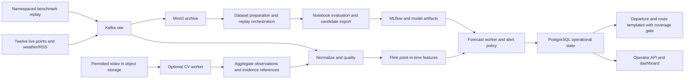

# LargeST, smart-traffic and smart_traffic_routing compared with Cognitive Traffic

Research date: 2026-10-26. Version 1.1, canonical English edition. The user approved these recommendations, now requirements B01–B06. Scope is the [12-point MVP](../requirements/cognitive-traffic-mvp-v1.md), operator first, departure/route support second, Data Engineering focused.

Evidence: historical reading of READMEs, ingestion/preprocessing/training/worker/stream/routing code, preparation notebooks, papers and distribution references. The three repositories were not executed; complete datasets were not downloaded/profiled; models, throughput and accuracy were not reproduced. Findings are static research, not proof of current external availability or runtime. Historical full edition: Git revision `43ac84e62ec06a0a92429d1db5d87ca056f6b804`.

## 1. Decision

LargeST informs data/benchmark organization; smart-traffic informs modality/inference/stream/storage separation; smart_traffic_routing informs prediction-to-choice UX. Idea suitability and implementation maturity are separate.

| Repository | Useful idea | MVP application | Limitation |
|---|---|---|---|
| LargeST | Sensor metadata, network adjacency, long history | Registry/subsets/manifests, temporal splits, accuracy/cost | California flow, not Vietnamese speed/ground truth |
| smart-traffic | Separate Kafka CV/ML workers, entity state, schemas/metrics | Worker/result contracts using existing Flink/MinIO/PostgreSQL | Different places/times; prediction horizon zero; graph-distance lookup is not routing |
| smart_traffic_routing | OD selection, route/forecast decision flow | Explain predicted conditions and choices | Hand-built graph and dummy features do not prove live adaptive routing |

Use METR-LA first for speed, a few lawful UA-DETRAC sequences for CV, and a later LargeST subset for flow/scale. NYC TLC lacks a current requirement. Actual 12-point data determines Vietnamese utility.

## 2. Inspected snapshots

| Repository | Inspected revision | Commit date |
|---|---|---|
| liuxu77/LargeST | `b7c6ff5f7f0c10051ed10a319b2cfe58021312f9` | 2023-11-01 |
| zubiiabbasi/smart-traffic | `02f33a82e80cbae8bd034d5e3616da82dc2cb014` | 2026-05-11 |
| devarshpatel1506/smart_traffic_routing | `24d92f7b15ccae72da14a99ca9bc5f579bb41e91` | 2025-09-25 |

GitHub truncated the routing repository recursive tree; directory listings of scripts/streaming were also read. This is not a whole-repository/binary/PDF audit. Source links are pinned for reproducibility.

## 3. LargeST: data and benchmarking

The paper describes California PeMS mainline data, 2017–2021, original five-minute cadence: CA 8,600 sensors, GLA 3,834, GBA 2,352, SD 716. Primary target is flow. Metadata includes location, road, direction, lanes and district. OSRM road-distance sensor graph and normalized adjacency serve models, not a travel-time edge table. Paper experiments use 2019 data, 15-minute resampling and chronological 60/20/20 splits. [Paper sections 4–5](https://arxiv.org/html/2306.08259v2).

The README points to Kaggle: five history HDF5 files, metadata CSV and adjacency NPY. Code is MIT; authors state dataset CC BY-NC 4.0. Check third-party baseline licenses separately; code and dataset rights differ. [README/license](https://github.com/liuxu77/LargeST/blob/b7c6ff5f7f0c10051ed10a319b2cfe58021312f9/README.md).

CA preprocessing uses `mean().round(0)` and `fillna(0)`. This convention does not make values 15-minute vehicle totals. Declare measurement/unit/aggregation and preserve missing masks. Generator adds time-of-day/day-of-week, normalizes and saves train/validation/test indices. Twelve history/future steps after resampling differ from the MVP's five-minute cadence. Its `DataFrame.append` needs pandas 2.x adaptation; do not import the old research environment into runtime dependencies. [Preprocessing](https://github.com/liuxu77/LargeST/blob/b7c6ff5f7f0c10051ed10a319b2cfe58021312f9/data/ca/process_ca_his.ipynb), [generator](https://github.com/liuxu77/LargeST/blob/b7c6ff5f7f0c10051ed10a319b2cfe58021312f9/data/generate_data_for_training.py).

**Keep:** per-sensor metadata, geographic subsets, explicit targets/splits, accuracy and cost reporting. Start small and scale replay/compaction research; an external labelled benchmark does not enlarge the 12-point product. **Change:** wide HDF5→canonical long sensor/time/value/unit/quality with provenance/manifests; split on time/target availability, fit transforms only on train, check horizon boundaries. Zero is not automatically missing; flow is not speed. **Defer:** all GNNs/full CA. Flow/scale research does not directly yield Hanoi/HCMC speed models; adjacency does not prove route validity.

## 4. smart-traffic: closest architecture, semantics need correction

The reference has sensor/GPS/CCTV/weather producers, Kafka YOLO/ML workers, Delta stream sinks, MinIO result images and a snapshot/image dashboard. Heavy inference/upload can have separate resources/retry policy. [Architecture](https://github.com/zubiiabbasi/smart-traffic/blob/02f33a82e80cbae8bd034d5e3616da82dc2cb014/README.md). Apply the separation to optional CV and existing forecasts; retain Flink event time/features, MinIO artifacts and PostgreSQL/API reads. No requirement justifies replacing the stack with Spark/Delta/Streamlit/ONNX. Consider ONNX only after measured inference/deployment benefit.

Multiple datasets do not establish fusion. Sensors use METR-LA speed with source time/ingested_at; GPS reads NYC taxi pickup/dropoff zones/times/distances; CCTV replays UA-DETRAC; weather is current OpenWeatherMap. These lack common Vietnamese location/time mapping. TLC trip-zone records are not per-edge GPS trajectories; official data notes accuracy limitations. [TLC](https://www.nyc.gov/site/tlc/about/tlc-trip-record-data.page), [GPS producer](https://github.com/zubiiabbasi/smart-traffic/blob/02f33a82e80cbae8bd034d5e3616da82dc2cb014/producers/gps_producer.py), [sensor producer](https://github.com/zubiiabbasi/smart-traffic/blob/02f33a82e80cbae8bd034d5e3616da82dc2cb014/producers/sensor_producer.py).

| Topic | Static finding | Required correction |
|---|---|---|
| Horizon | Worker emits horizon_minutes=0, actual/prediction share time | Explicit shifted target/target time before +15/+60 claim |
| Evaluation | train_test_split with shuffle=True | Chronological/walk-forward future evaluation |
| Features | grouped.shift(1).rolling operates on flattened Series; online rolling per sensor | Grouped rolling, boundary tests, offline/online parity |
| Warm start | Thirty-minute default, lag_1h needs twelve five-minute samples | Bootstrap full history with correct cutoff |

[Trainer](https://github.com/zubiiabbasi/smart-traffic/blob/02f33a82e80cbae8bd034d5e3616da82dc2cb014/ml/train_speed_model.py), [worker](https://github.com/zubiiabbasi/smart-traffic/blob/02f33a82e80cbae8bd034d5e3616da82dc2cb014/ml_predictor_worker/main.py).

| CV/stream topic | Static finding | Required correction |
|---|---|---|
| Count | unique_count_5min counts appeared track IDs in processing time | Not line-crossing flow, queue length or density; add/evaluate actual ROI/line definition |
| Replay time | Producer assigns time.time; worker current-clock windows/stale drop | Preserve clip/frame observation time, independent of replay speed |
| Recovery | In-memory tracks/count, offset commit independent of publish acknowledgment, errors can return | No inferred exactly-once; explicit fail/retry/DLQ/idempotent sink and restart/rebalance evidence |
| Transport | Base64 Kafka frames; MinIO annotated images | Prefer checksummed video/frame references; retain raw evidence only within rights/retention |

[YOLO worker](https://github.com/zubiiabbasi/smart-traffic/blob/02f33a82e80cbae8bd034d5e3616da82dc2cb014/yolo_worker/main.py), [CCTV producer](https://github.com/zubiiabbasi/smart-traffic/blob/02f33a82e80cbae8bd034d5e3616da82dc2cb014/producers/cctv_producer.py).

`graph_analytics.py` computes NetworkX shortest-path hop counts to landmarks; stream_sensors looks them up below a speed threshold. It does not reroute around predicted congestion. The metadata loader can place real sensors on a synthetic grid when CSV is absent; that does not verify location. [Graph](https://github.com/zubiiabbasi/smart-traffic/blob/02f33a82e80cbae8bd034d5e3616da82dc2cb014/spark_jobs/graph_analytics.py), [stream](https://github.com/zubiiabbasi/smart-traffic/blob/02f33a82e80cbae8bd034d5e3616da82dc2cb014/spark_jobs/stream_sensors.py), [metadata](https://github.com/zubiiabbasi/smart-traffic/blob/02f33a82e80cbae8bd034d5e3616da82dc2cb014/spark_jobs/load_sensor_metadata.py).

CV conversion splits XML/sequences rather than random frames, which is useful, but merges official train/test XML then resplits: preserve manifest and do not claim official-benchmark comparability. It collapses objects to vehicle and drops unlabelled frames; reconsider negatives and motorcycles locally. [Converter](https://github.com/zubiiabbasi/smart-traffic/blob/02f33a82e80cbae8bd034d5e3616da82dc2cb014/scripts/convert_yolo_fast.py). Adopt worker/schema/metric ideas; correct time, measurement, evaluation and recovery before code reuse.

## 5. smart_traffic_routing: useful decision flow, illustrative execution

README traffic/weather/incident→features→prediction/classification→edge costs→route→dashboard fits the secondary user journey. Present routes with conditions/reasons rather than disconnected charts. [Architecture](https://github.com/devarshpatel1506/smart_traffic_routing/blob/24d92f7b15ccae72da14a99ca9bc5f579bb41e91/README.md).

The traffic producer reads local PeMS station/flow/occupancy/speed/location but replaces historical time with current UTC and emits every second. Incidents are random; weather is current Open-Meteo. This is integration simulation, not aligned historical context labels. Input CSVs were not found at inspected paths; source paths refer to the author's Desktop. The repository is not a verified packaged dataset. [Traffic](https://github.com/devarshpatel1506/smart_traffic_routing/blob/24d92f7b15ccae72da14a99ca9bc5f579bb41e91/streaming/kafka_traffic_producer.py), [incident](https://github.com/devarshpatel1506/smart_traffic_routing/blob/24d92f7b15ccae72da14a99ca9bc5f579bb41e91/streaming/kafka_incident_producer.py), [weather](https://github.com/devarshpatel1506/smart_traffic_routing/blob/24d92f7b15ccae72da14a99ca9bc5f579bb41e91/streaming/kafka_weather_producer.py).

MongoDB join rounds coordinates to one decimal, permits context later than traffic and inner-joins weather, losing unmatched traffic. No available_at check blocks future context. The inspected XGBoost is same-row speed regression with random split and zero imputation; another script uses LinearRegression. The described LSTM→XGBoost classifier path and README metrics were not reproduced. [Join](https://github.com/devarshpatel1506/smart_traffic_routing/blob/24d92f7b15ccae72da14a99ca9bc5f579bb41e91/streaming/spark_mongodb_writer.py), [XGBoost](https://github.com/devarshpatel1506/smart_traffic_routing/blob/24d92f7b15ccae72da14a99ca9bc5f579bb41e91/scripts/xgboost_model.py), [training](https://github.com/devarshpatel1506/smart_traffic_routing/blob/24d92f7b15ccae72da14a99ca9bc5f579bb41e91/scripts/model_training.py).

A* and dashboard use an undirected manually connected city/landmark graph, geodesic distance and the same dummy feature row per edge: model speeds are identical across edges in one graph, rather than live/arrival-dependent costs. Very low speed becomes 5.0. Heuristic distance km and travel-time-hour weights have inconsistent units/lower bound; optimality is not established. Use Dijkstra first or a same-unit admissible travel-time lower bound with justified maximum speed. NetworkX warns overestimating heuristics may miss shortest paths. [A*](https://github.com/devarshpatel1506/smart_traffic_routing/blob/24d92f7b15ccae72da14a99ca9bc5f579bb41e91/A%2A/a_star_routing.py), [dashboard](https://github.com/devarshpatel1506/smart_traffic_routing/blob/24d92f7b15ccae72da14a99ca9bc5f579bb41e91/dashboard/dashboard.py), [NetworkX contract](https://networkx.org/documentation/stable/reference/algorithms/generated/networkx.algorithms.shortest_paths.astar.astar_path.html).

Learn the decision UX and forecast-dependent cost idea; do not adopt this as the routing engine. Directed network, lengths, vehicle access, mapping and ETA validation remain open.

## 6. Dataset fitness

| Dataset | Actual measurement | Useful for | Does not establish |
|---|---|---|---|
| Twelve Vietnamese points | Provider speed/travel context, local weather/RSS | Primary usability/alerts/forecast/case study | All roads/directions in either city |
| METR-LA | Freeway speed series/sensor adjacency | +15/+60 speed, features/replay, fixed small subset | Vietnamese validity or full road graph |
| LargeST | California flow series/metadata/adjacency | Missingness/slices/data engineering/flow/scale | Speed by renaming, or ETA ground truth |
| UA-DETRAC | Sequences, boxes/tracks, filming conditions | Detector/tracker/count/ROI/reproducible replay | Paired METR-LA or Vietnamese video |
| NYC TLC | Taxi times/zones/distances | Deferred unless OD-demand/reliability problem arises | Per-edge trajectory or Vietnamese demand |
| Routing PeMS CSV | Author-local flow/occupancy/speed | Adapter contract after provenance/schema/unit/availability checks | Real aligned traffic/weather/synthetic-incident labels |

UA-DETRAC paper describes 100 sequences, over 140,000 frames, weather/occlusion/category/box labels. Distribution site could not be accessed during original research; current download availability/specific rights were not verified. [Paper](https://arxiv.org/abs/1511.04136).

## 7. Proposed logical architecture

This is a proposal, not proof every edge runs. The notebook evaluation boundary incorporates the later approved N01–N05 requirement. Benchmark dataset/measurement/live-replay identity must prevent writes to Vietnamese current state/metrics. Shared code in separated runs/configs suffices; no new cluster required.

Separate benchmark capability from operational capability in manifests/UI/registry. Establish speed/flow/ROI count/unique tracks/queue semantics before modelling. Preserve target/horizon and event/availability/replay time adapter→feature→forecast→outcome. CV owns detection/tracking/artifacts; Flink owns event-time features; heavy inference is not a synchronous feature-job call. Sensor impact graph is not road routing; hop count is not ETA. Show unsupported/insufficient evidence rather than invented locations.

## 8. Recommended sequence

1. Complete 12-point registry/provenance: mapping, timestamp basis, quality and blind spots.
2. METR-LA speed benchmark with fixed subset/split/units, correct +15/+60 targets and reused feature logic; label separately.
3. Few lawful CV sequences with source timing, sequence split, line/ROI/manual labels and measured runtime.
4. LargeST subset only for flow/scale need; separate schema/missing mask/aggregation, never merge into speed training.
5. Complete monitoring/template cards with explicit live/replay evidence; no extra points to make a route demo.

Three public datasets are unnecessary for a multimodal label. Three working adapters prove technical integration; fusion improvement requires aligned place/time and suitable ablation.

## 9. Resulting decision

Use smart-traffic for worker boundaries, LargeST for data/benchmark design and smart_traffic_routing for decision UX and routing pitfalls. Preserve Kafka/Flink/MinIO/PostgreSQL and the 12-point MVP. The useful chain is provenance→point-in-time features→separate inference→operational state→evidenced decisions→outcomes/replay. Demonstrate decision quality on suitable data rather than count modalities or model names.
